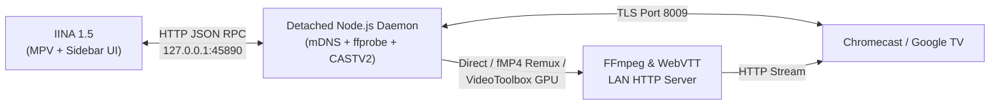

# IINA Chromecast Plugin (`io.iina.chromecast`)

A high-performance **Chromecast / Google TV / Android TV** plugin for **IINA** on macOS, featuring automatic codec analysis, lossless on-the-fly `fMP4` remuxing, Apple Silicon hardware-accelerated `H.264` transcoding (`VideoToolbox`), live audio/subtitle track switching, native IINA control mirroring, and multi-language support (**English**, **Français**, **Español**).

---

## ✨ Key Features

1. **Zero-Config mDNS Discovery**:
   - Automatically discovers video-capable Chromecast, Google TV, and Android TV devices on your local network (`_googlecast._tcp.local`) while filtering out audio-only speakers.
   - Detects **4K / HEVC (H.265)** support automatically (Chromecast Ultra, Google TV, 4K Android TV).
2. **Smart 3-Tier Streaming Engine**:
   - **Direct Play**: Native `.mp4` (`H.264`/`HEVC` + `AAC`/`MP3`) and `.webm` (`VP8`/`VP9` + `Opus`/`Vorbis`) files are streamed via HTTP `206 Partial Content` byte-ranges with **0% CPU usage**.
   - **Lossless Live Remuxing**: `.mkv`, `.avi`, `.mov`, or `.ts` files with compatible video streams are remuxed on the fly (`-c:v copy`) into fragmented MP4 (`fMP4`) while converting incompatible audio (`AC3`, `DTS`, `EAC3`) to `AAC` with strict A/V sync (`-noaccurate_seek` + `aresample=async=1`).
   - **Hardware GPU Transcoding (`h264_videotoolbox`)**: Incompatible video codecs (`10-bit HDR`, `AV1`, `HEVC` on older 1080p Chromecasts) are hardware-decoded and hardware-encoded in real time using macOS `VideoToolbox`.
3. **Live Subtitles & Multi-Audio Switching**:
   - Extracts embedded subtitles or external `.srt`/`.ass`/`.ssa` files to **WebVTT** on the fly with live timestamp shifting on seek.
   - Switch audio tracks or subtitles directly from the Chromecast sidebar or IINA's native menus while casting.
4. **Native IINA Control Mirroring & Playlist Auto-Advance**:
   - Use IINA's native **Space (Play/Pause)**, **Timeline Seek bar**, **Volume**, and **Next/Previous Track** buttons to control the Chromecast directly.
   - Reuses the active Chromecast receiver session across playlist episodes for fast, seamless transitions.
5. **Multi-Language Interface (`en`, `fr`, `es`)**:
   - Full localization in **English**, **French**, and **Spanish** (automatic system detection or manual selection in the Sidebar and Preferences).

---

## 🏗 Architecture Overview



👉 **For detailed architecture diagrams, IINA 1.5 thread-safety analysis, and sequence workflows, see [`docs/ARCHITECTURE.md`](docs/ARCHITECTURE.md).**

---

## 📦 External Dependencies & Prerequisites

To stream and transcode videos in real time to Chromecast devices, this plugin relies on two standard macOS tools:

| Dependency | Purpose | Recommended Installation |
|---|---|---|
| **FFmpeg** (`ffmpeg` & `ffprobe`) | Stream codec analysis, lossless `fMP4` remuxing, WebVTT subtitle extraction, and GPU hardware transcoding | `brew install ffmpeg` |
| **Node.js** (v18+) | Runs the detached background Chromecast daemon (mDNS discovery & TLS CASTV2 control) | `brew install node` |

### Quick Install via Homebrew:
```bash
brew install ffmpeg node
```
*(Or via MacPorts: `sudo port install ffmpeg nodejs22`)*

> [!TIP]
> If installed in custom locations, you can configure their paths directly in **IINA** → **Settings** → **Plugins** → **Chromecast**.

---

## 🚀 Installation in IINA

1. Open **IINA** → **Settings** (`Cmd + ,`) → **Plugins**.
2. Click the **`+`** button (Install from GitHub / URL).
3. Paste the project URL:
   ```text
   https://github.com/julienperrault/iina-chromecast
   ```
4. Click **Install**.
5. Open any video in IINA and open the **Chromecast** sidebar tab (shortcut: `Option + C` or menu **Plugin → Chromecast**).

> **For Developers**: You can also link local changes live into IINA via `make link` or `npm run link`.

---

## 🛠 Development, Linter & Makefile

The project includes a dedicated static analyzer & i18n linter ([`lint.js`](lint.js)) and a [`Makefile`](Makefile):

```bash
# Show all available Make targets
make help

# Run the linter (JS syntax, IINA 1.5 anti-deadlock checks, HTML inline scripts, en/fr/es i18n parity)
make lint

# Audit codebase for unused translation keys & dead code
make deadcode

# Bundle and minify dist/daemon.js and dist/index.js
make build

# Run lint + build + restart background daemon
make check

# Check or restart the background Chromecast daemon manually
make daemon-status
make daemon-restart

# Create a distributable .iinaplugin.zip package
make package
```

---

## 📁 Project Structure

```text
iina-chromecast/
├── Info.json              # IINA plugin manifest, permissions, defaults & localized metadata (en/fr/es)
├── LICENSE                # GNU General Public License v3.0 (GPLv3)
├── Makefile               # Build, lint, daemon lifecycle & packaging automation
├── build.js               # esbuild bundler + build-time protobufjs descriptor compiler
├── lint.js                # Static analyzer, IINA 1.5 thread-safety verifier & i18n checker
├── package.json           # Dependencies & npm scripts
├── docs/
│   └── ARCHITECTURE.md    # Detailed architecture & Mermaid workflow diagrams
├── i18n/
│   ├── en.json            # English translations (default fallback)
│   ├── fr.json            # French translations
│   └── es.json            # Spanish translations
├── src/
│   ├── index.js           # IINA sandbox plugin entry point (events, RPC client, sidebar sync)
│   ├── daemon.js          # Detached Node.js daemon (mDNS, ffprobe, FFmpeg HTTP server, CASTV2)
│   └── i18n.js            # Shared multi-language loader & formatter
└── ui/
    ├── sidebar.html       # Streamlined Chromecast sidebar UI (Devices, Tracks, Cast/Stop)
    └── preferences.html   # Plugin preferences page (Language, Strategy, 4K/HEVC, Bitrate, Paths)
```

---

## 📜 License

This project is licensed under the **GNU General Public License v3.0 (GPLv3)** — see the [LICENSE](LICENSE) file for details.

