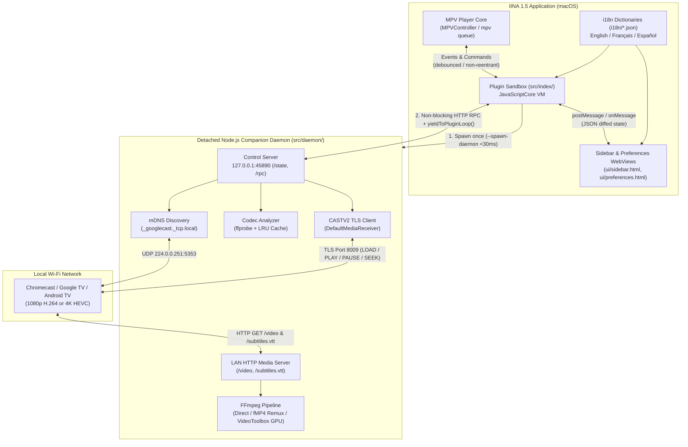
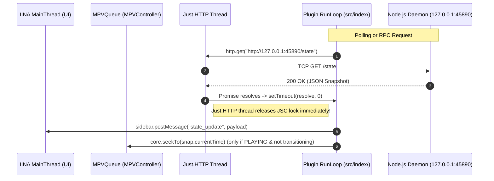
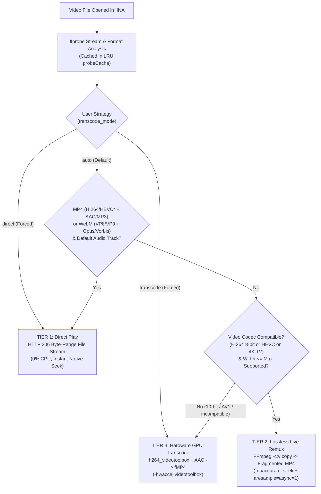
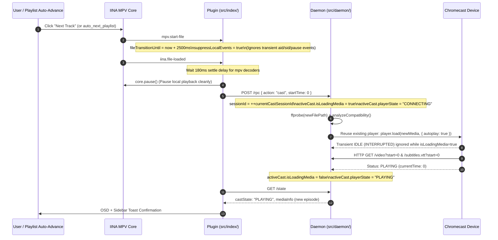

# Architecture & Technical Workflows (`io.iina.chromecast`)

This document details the internal architecture, thread-safety design for **IINA 1.5**, media streaming pipeline, and synchronization workflows of the **IINA Chromecast Plugin**.

---

## 1. High-Level System Architecture

Because IINA's JavaScript plugin environment runs inside **JavaScriptCore (`JSC`)** without native Node.js sockets (`net`, `tls`, `dgram`, `http`), the plugin splits responsibilities across **three isolated components**:

1. **IINA Plugin Sandbox ([`src/index/`](../src/index/index.ts))**:
   - Runs inside IINA's JavaScriptCore context.
   - Listens to `mpv` and `iina` lifecycle events (`iina.file-loaded`, `mpv.pause.changed`, `mpv.playback-restart`, `mpv.aid.changed`, `mpv.sid.changed`, `mpv.volume.changed`).
   - Spawns the companion Node.js daemon in detached mode (`--spawn-daemon`) and communicates with it via local HTTP RPC (`http://127.0.0.1:45890`).
2. **Sidebar & Preferences WebViews ([`ui/sidebar.html`](../ui/sidebar.html), [`ui/preferences.html`](../ui/preferences.html))**:
   - Render reactive UI controls with DOM signature diffing, animated scan feedback, toast notifications, and instant multi-language switching (`en`, `fr`, `es`).
3. **Detached Companion Daemon ([`src/daemon/`](../src/daemon/daemon.ts))**:
   - Persistent Node.js process listening on `127.0.0.1:45890` (Control RPC) and a dynamic LAN port (Media & WebVTT HTTP server).
   - Performs mDNS discovery (`_googlecast._tcp.local`), `ffprobe` analysis, `FFmpeg` remuxing / hardware GPU transcoding (`h264_videotoolbox`), WebVTT subtitle extraction, and `CASTV2` TLS socket communication with Chromecast devices.

---

## 2. IINA 1.5 Thread-Safety & Anti-Deadlock Workflow

IINA 1.5 introduces three subtle threading hazards in its plugin bridge:

1. **`utils.exec` Serial Queue Blocking**:
   - `JavascriptAPIUtils.exec` calls `Process.waitUntilExit()` synchronously on a serial `DispatchQueue`. Spawning a long-lived server directly via `utils.exec` permanently freezes all subsequent `utils.exec` calls.
   - **Solution**: [`src/daemon/daemon.ts`](../src/daemon/daemon.ts) supports `--spawn-daemon`, which forks a detached background process (`detached: true, stdio: "ignore"`), calls `child.unref()`, and exits `0` in **< 30 ms**.
2. **`Just.HTTP` Background Thread + `JSC` Lock Deadlock**:
   - `iina.http.get` / `iina.http.post` resolves JavaScript promises directly inside `Just.HTTP`'s background completion thread while holding the `JSContext` lock. Calling `core.*` or `sidebar.postMessage` (which dispatches to `MainThread`) directly inside that continuation causes a lock-order inversion with `MainThread` and `MPVQueue`.
   - **Solution**: Every `await http.get(...)` and `await http.post(...)` is immediately followed by [`await yieldToPluginLoop()`](../src/index/daemon-client.ts) (`new Promise(r => setTimeout(r, 0))`), which releases the `Just.HTTP` thread lock immediately and resumes execution cleanly on IINA's plugin timer loop.
3. **Reentrant `mpv.*` Event Storms During File Transitions**:
   - When switching playlist items ("Next Track"), `mpv` emits `mpv.start-file`, `mpv.aid.changed`, `mpv.sid.changed`, `mpv.pause.changed`, `iina.file-loaded`, and `mpv.playback-restart` in rapid succession on the `mpv` queue.
   - **Solution**: All `mpv.*` listeners are guarded by [`isFileTransitioning()`](../src/index/state.ts) and debounced via `setTimeout`, preventing any synchronous reentrant call into `MPVController`.

---

## 3. 3-Tier Media Compatibility & Streaming Workflow

When a video is opened or cast, [`analyzeCompatibility()`](../src/daemon/compatibility.ts) inspects its container, video codec, pixel format (`8-bit` vs `10-bit`), resolution, audio tracks, and the target Chromecast's capabilities (`1080p` vs `4K / HEVC`) to choose the lowest-overhead streaming mode:

### Audio / Video Sync Guarantees (`Remux` & `Transcode`)
In [`handleVideoRequest()`](../src/daemon/streamer.ts), fragmented MP4 (`fMP4`) streaming uses specific FFmpeg flags to eliminate A/V desynchronization:
- **`-noaccurate_seek` before `-ss <start>` (in Remux mode)**: When copying video (`-c:v copy`), FFmpeg must start at the nearest preceding keyframe. Without `-noaccurate_seek`, FFmpeg drops audio samples between that keyframe and `<start>` while keeping the video frames, creating a 1–5 second audio lag.
- **`-af aresample=async=1`**: Automatically compensates for timestamp drift or gaps when transcoding audio (`AC3`/`EAC3`/`DTS` → `AAC`).
- **`-avoid_negative_ts make_zero`** + **`-movflags frag_keyframe+empty_moov+default_base_moof+negative_cts_offsets`**: Ensures clean PTS/CTS alignment from `0.000s` in the fragmented MP4 container.

---

## 4. Playlist "Next Track" & Live Session Reuse Workflow

When the user clicks **"Next Track" (Titre suivant)** in IINA or when an episode finishes (`FINISHED` status on Chromecast):

---

## 5. Multi-Language Architecture (`i18n/*.json`)

All localized strings are stored in separate, clean JSON dictionaries:
- [`i18n/en.json`](../i18n/en.json) (English, default fallback)
- [`i18n/fr.json`](../i18n/fr.json) (French)
- [`i18n/es.json`](../i18n/es.json) (Spanish)

A lightweight shared formatter in [`src/shared/i18n.ts`](../src/shared/i18n.ts) provides parameter substitution (`t(lang, "key", { param })`) and automatic fallback to English if a key is missing. The static analyzer ([`lint.js`](../lint.js)) automatically validates 100% key and placeholder parity across all three languages before every build.
